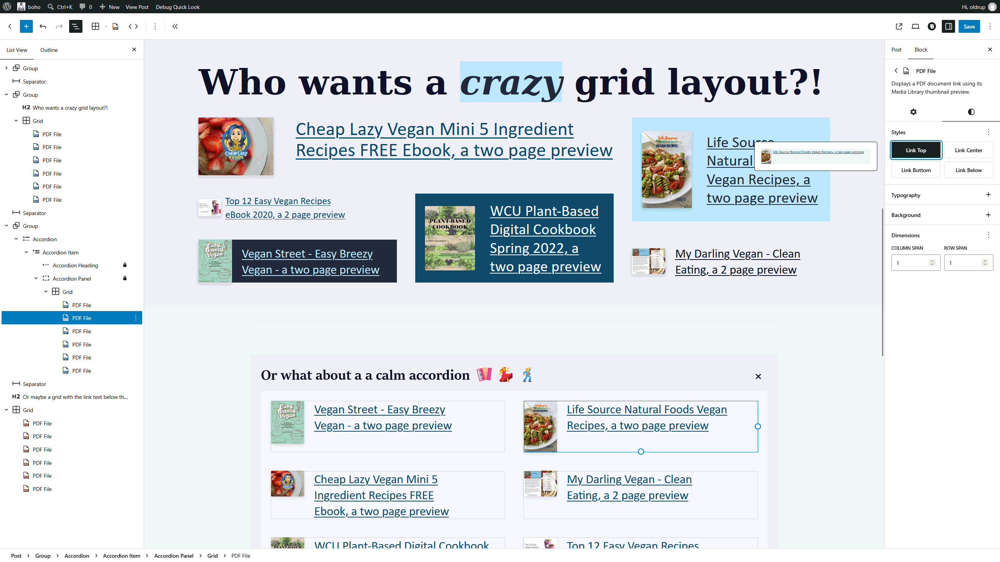

# Codeally PDF Link

Adds a native WordPress Block Editor block that links to PDFs with Media Library thumbnails.

- **Version:** 1.5.0
- **Requires:** WordPress 6.9+, PHP 8.2+
- **Tested up to:** WordPress 7.1
- **License:** GPL-2.0-or-later

**Tags:** pdf, block, gutenberg, media-library, accessibility

## Description

Codeally PDF Link adds a native WordPress Block Editor (Gutenberg) block for linking to PDFs with Media Library thumbnails. It does not support Elementor, Divi, or other third-party page builders.

WordPress generates the thumbnail on upload when the server supports PDF image processing (typically Imagick and Ghostscript); otherwise, a generic media icon is used. The block has four layout styles, standard color, typography, and padding controls, and a screen-reader label identifying the PDF. It has no external runtime dependencies.

Developed by [Bjarne Oldrup](https://oldrup.dk/) and sponsored by [Codeally](https://codeally.dk/).

## Screenshots



## Installation

1. Install **Codeally PDF Link** from the WordPress Plugins screen, or upload the plugin folder to `/wp-content/plugins/`.
2. Activate the plugin, add a **PDF Link** block, and select a PDF from the Media Library.

## Customize thumbnail styling

Add one of these optional classes under the block's **Advanced > Additional CSS class(es)** setting to size the thumbnail using the matching theme font-size preset:

- `cdly-pdf-link--small`
- `cdly-pdf-link--medium`
- `cdly-pdf-link--large`
- `cdly-pdf-link--x-large`
- `cdly-pdf-link--xx-large`

The theme must define the matching preset. Alternatively, set these CSS custom properties on the block or an ancestor:

| Property | Purpose | Default |
| --- | --- | --- |
| `--cdly-pdf-width` | Thumbnail width | `2.5em` |
| `--cdly-pdf-gap` | Space between thumbnail and link text | `0.5em` |
| `--cdly-pdf-shadow` | Thumbnail drop shadow | Layered drop shadow |
| `--cdly-pdf-hover` | Additional thumbnail filter on hover | `saturate(115%) contrast(115%)` |

For example:

```css
.wp-block-cdly-pdf-link {
    --cdly-pdf-width: 4em;
    --cdly-pdf-gap: 1em;
}
```

## Accessibility and compatibility

- The link has a visually hidden “PDF” label for screen-reader users.
- The thumbnail is a clickable hit area for the same link as the title; there is only one link in the markup.
- The visible keyboard focus outline is preserved.
- Keyboard navigation and screen-reader behavior have been tested with Windows Narrator and NVDA.
- The generated front-end markup is valid HTML, and the plugin passes WordPress Plugin Check.

As of September 2026, the plugin has been tested with Twenty Twenty-Five, Greyd, and Ollie (Full Site Editing themes), and Blocksy, Kadence, and GeneratePress (classic themes).

## Frequently asked questions

### What happens if I deactivate the plugin?

The saved link remains on the front end. The thumbnail is added with CSS, so it disappears when the plugin stylesheet is no longer loaded. In the editor, WordPress may report the block as unavailable; choose to keep its content to preserve the link.

## Changelog

### 1.5.0

- Add optional thumbnail size classes based on theme font-size presets.

### 1.4.0

- Previous stable release.

## Localization

- Text domain: `codeally-pdf-link`
- Translation template: `languages/codeally-pdf-link.pot`

## License

GPL-2.0-or-later. See the [GNU General Public License, version 2](https://www.gnu.org/licenses/gpl-2.0.html).
